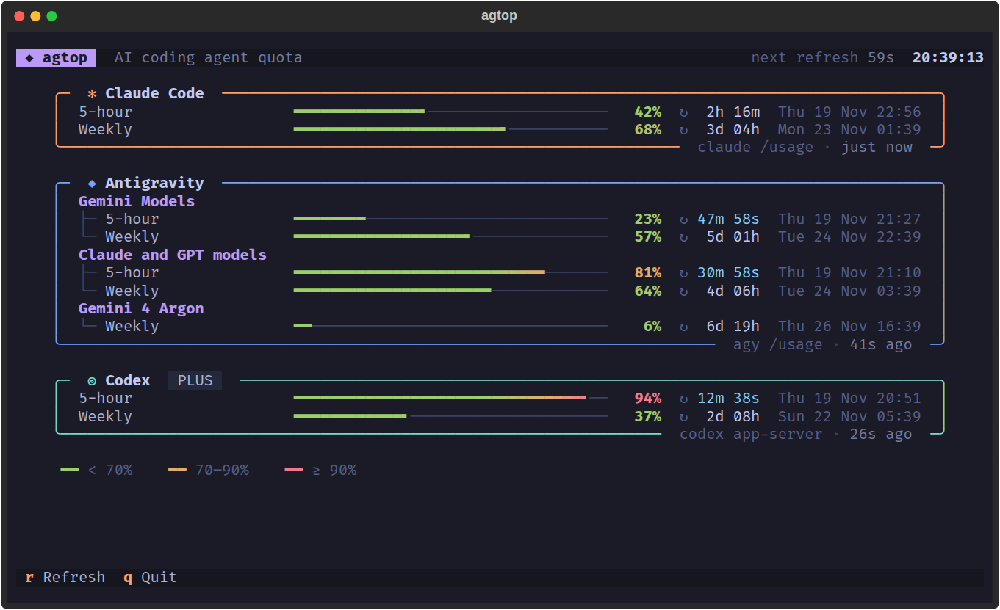

# agtop

`htop`, but for AI coding agent quotas. A small terminal UI that shows how much of the
**5-hour** and **weekly** usage windows you have used, and when each window resets, for:

- **Claude Code** (`claude`)
- **Antigravity** (`agy`)
- **Codex** (`codex`)



*(Screenshot uses sample data.)*

## How it works

agtop asks each agent's **own CLI** for its usage in non-interactive mode. The CLIs handle
auth and token refresh themselves, and these calls run **0 model turns**, so checking your quota
does not consume any quota.

| Agent | Source | Fallback |
|---|---|---|
| Claude Code | `claude -p "/usage" --output-format json` | Anthropic OAuth usage endpoint, using the local Claude Code token |
| Antigravity | `agy -p "/usage" --output-format json` (per model group) | none |
| Codex | `codex app-server` → JSON-RPC `account/rateLimits/read` | latest `rate_limits` event in `~/.codex/sessions/**/rollout-*.jsonl` |

The providers run in parallel threads. If one fails, only its card shows an error. An agent
that is not installed or not logged in shows a one-line reason.

Safety rules:

- agtop never prints or logs tokens, and never refreshes OAuth tokens. If a token has expired,
  open the agent once and it will refresh the token itself.
- The only token agtop reads is Claude Code's, and only in its fallback path. It sends it only
  to Anthropic's own API.
- agtop never sends prompts.
- Antigravity results are cached for 2 minutes, because every `agy` call writes a log file.
  Codex results are cached for 3 minutes. The cache lives in `~/.cache/agtop/`.

## Install

Requires Python 3.10+ on Linux, macOS, or WSL2.

```bash
git clone https://github.com/nguyentamgm/agtop.git ~/agtop
~/agtop/install.sh      # creates ~/agtop/.venv and the ~/.local/bin/agtop launcher
```

The install script uses [`uv`](https://github.com/astral-sh/uv) if it is available. Otherwise
it falls back to `python3 -m venv`. Make sure `~/.local/bin` is on your `PATH`.

## Usage

```bash
agtop            # interactive TUI, auto-refreshes every 60s
agtop --once     # print once and exit (pipe-friendly, ≥100 columns)
agtop --json     # machine-readable output
```

TUI keys: `r` refresh now · `q` quit.

Bar colors: green below 70%, amber from 70% to 90%, red at 90% and above.

```bash
# example: one line per window
agtop --json | jq -r '.[] | .agent as $a | .windows[] | "\($a) \(.group) \(.label): \(.percent_used)%"'
```

### Environment

| Variable | Effect |
|---|---|
| `AGTOP_CLAUDE_FALLBACK=1` | force the Claude OAuth API fallback (for testing) |
| `CODEX_HOME` | extra Codex data dir to scan for session logs |

## Notes

- On WSL2, agtop also finds a Windows-side Codex install
  (`/mnt/c/Users/*/AppData/Local/OpenAI/Codex/bin/*/codex.exe`) and runs it from `/mnt/c`.
- The Codex log fallback only reflects usage up to the last time you used Codex.
- These usage commands and endpoints are not stable public APIs. They may change between agent
  versions.
